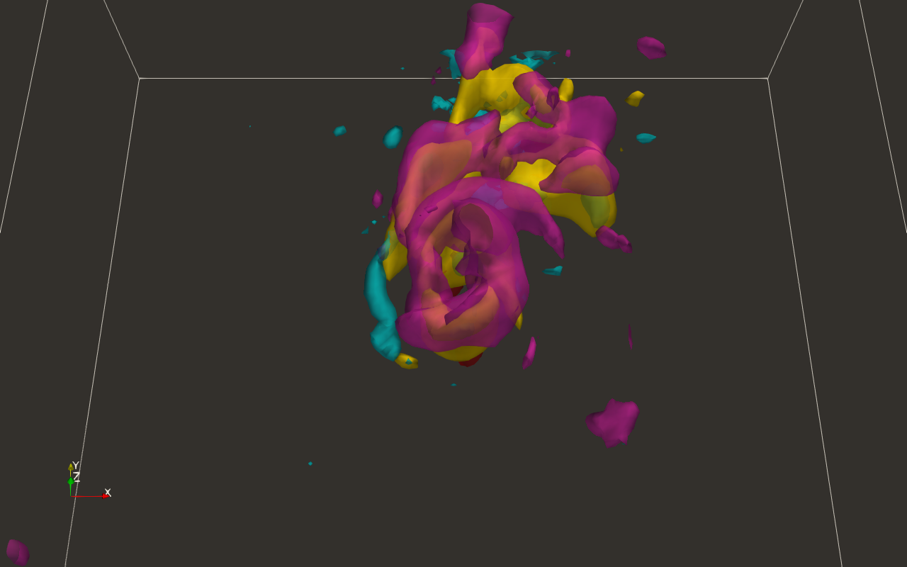
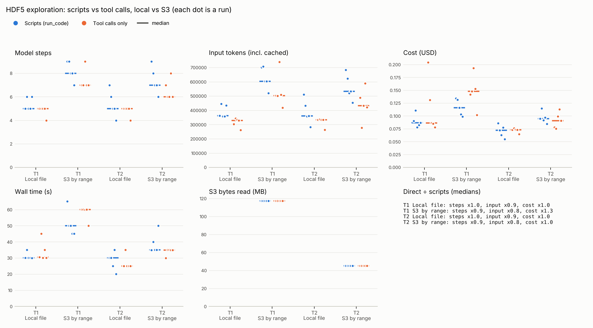

# Hurricane Helene: HDF5 data in a CLIO conversation

A recorded walkthrough and a benchmark built on ERA5 reanalysis of Hurricane Helene
(24–27 September 2024). The point is to show HDF5/NetCDF data being worked on the way a
person works: plain requests, references to the exact dataset, the file viewer, the
agent's measurements, a 3D view in ParaView, and a dashboard to share.

## What the walkthrough shows

One continuous conversation, typed at human pace, with no tool or step named in any
request. The person:

1. References `msl_2024-09.nc` with `@` and asks "What's in here?". The answer lists the
   variables, with `MSL` as a link to that dataset.
2. Clicks `MSL` in the answer. The Files viewer opens it, and the person reads its
   attributes, looks at the image, and adds the field to the message from the viewer.
3. Asks for Helene's track and central pressure from the 24th to the 27th.
4. Asks how fast it deepened and whether the water was warm enough. The sea-surface
   temperature field is referenced as `@sst_2024-09.nc › /SSTK` with the composer's `@`.
5. Asks what the clouds looked like on the 26th, from above and tilted, each kind of water
   in its own colour, thin wisps hidden. The agent offers ParaView; the person clicks Add.
6. Asks for a dashboard to share. The person shows it full screen, scrolls it, and returns.
7. Asks to step through the days with everything following, the 3D view too.
8. Steps the dashboard's 3D view to landfall, raises a surface or turns the storm, and asks
   what changed.



*Take 13: ice (magenta), snow (yellow), cloud droplets (cyan) and rain (red) on 26 Sep at
18 UTC, as the agent drew it from request 5.*

### What a take is evidence of

Every request is a plain request, so a take is evidence of the agent's own choices: which
tools it uses, how it cuts the data, and how it draws the view. It is one run, not a
measured rate; the 3D look varies from run to run. The scripted clicks (opening the field,
the dashboard tour, the final beat's stepping and dragging) are the person's actions, not
the agent's.

The view is limited by the data. ERA5 is a 0.25° (about 28 km) reanalysis, so the
storm's inner core is smoothed. Fine eyewall structure, as in kilometre-scale model
output, is not in these fields.

## Run it

Use a cloud session or a local source checkout with ParaView 6 (`pvpython`) available.

1. Fetch the data, 18 files and about 4.4 GB:

   ```bash
   uv run --frozen --no-sync python scripts/demo/helene/fetch_era5.py /data/era5
   ```

2. Start a clean stack and enable ParaView. In a cloud session:

   ```bash
   CLIO_CLOUD_ISOLATE=1 CLIO_DEFAULT_MARKETPLACE=/path/to/clio-agent-marketplace \
     CLIO_BROWSER_ALLOW_UNSANDBOXED=1 bash scripts/cloud/stack.sh start
   ```

   ```bash
   curl -X PUT localhost:8787/v1/connectors/paraview/values -H 'content-type: application/json' \
     -d '{"values":{"prepare":"export PATH=/opt/pv6/bin:$PATH"}}'
   ```

   ```bash
   curl -X POST localhost:8787/v1/connectors/paraview/enable -H 'content-type: application/json' \
     -d '{"scope":"all"}'
   ```

   For CLIO branding in the web UI, gact-tui needs a git-ignored `brand.config.local.json`
   with `{"profile":"clio","brandingRoot":"/path/to/clio-agent/branding"}`.

3. Make the workspace. Put the files in `ROOT/era5/` (hard links are enough), then:

   ```bash
   NO_S3=1 uv run --frozen --no-sync python scripts/demo/helene/setup_ws.py ROOT "Hurricane Helene in ERA5"
   ```

   It prints the workspace and session ids. Without `NO_S3=1` it also links the public
   ERA5 pressure-level prefix as an anonymous S3 source, read by range.

4. Record one continuous take:

   ```bash
   WS=<workspace id> SID=<session id> node scripts/cloud/ui_check.mjs \
     --steps scripts/cloud/checks/apps/helene_hdf5.mjs --label take --video --width 1600 --height 1000
   ```

   `TURNS=contents,track,…` runs a subset of the turns, `SHOW_CURSOR=0` hides the drawn
   pointer, `HIDE_SIDEBAR=0` keeps the workspace list, and `BEAT_ASK=0` stops before the
   last question. Each `MARK name seconds` line in the output is a beat. The video runs a
   few seconds ahead of the marks; check one frame to find the offset.

5. Convert it:

   ```bash
   ffmpeg -ss 10 -i .cloud-run/shots/take.webm -vf "fps=30,format=yuv420p" -c:v libx264 -crf 22 helene.mp4
   ```

A take runs about 12 minutes with Sonnet 5.5.

## Benchmark: tool calls against scripts, local file against S3

`scripts/eval/hdf5_bench/` asks two questions of the same ERA5 data, again in plain
requests:

- **T1:** the lowest mean sea-level pressure in the Gulf box every 6 hours, 24–27 September.
- **T2:** the largest cloud liquid water in the box at four hours on the 26th.

Each is asked under two arms and two data locations:

- **Tool calls only:** start the server with `CLIO_TOOLS_WITHHELD=run_code,shell_bash`.
- **Scripts (`run_code`):** the default tools.
- **Local file:** the ERA5 files sit in the run's workspace.
- **S3 by range:** the public bucket is linked and read by range.

Every answer is graded against `ground_truth.py`.

```bash
uv run --frozen --no-sync python -m scripts.eval.hdf5_bench.run --arm ptc --where local --tasks T1,T2 --n 5 --era5 /data/era5
```

```bash
uv run --frozen --no-sync python -m scripts.eval.hdf5_bench.summarize
```

Results (Sonnet 5.5, 5 runs per cell, median [min–max]):

| Task | Data | Arm | Score | Wall s | Steps | Cost USD | S3 MB read |
|---|---|---|---|---|---|---|---|
| T1 | Local file | Tool calls only | 1.00 | 31 [30–45] | 5 [4–5] | 0.09 [0.08–0.20] | – |
| T1 | Local file | Scripts | 1.00 | 30 [30–35] | 5 [5–6] | 0.09 [0.08–0.11] | – |
| T1 | S3 by range | Tool calls only | 1.00 | 60 [50–60] | 7 [7–9] | 0.15 [0.10–0.19] | 117 |
| T1 | S3 by range | Scripts | 1.00 | 50 [45–65] | 8 [7–9] | 0.12 [0.10–0.13] | 117 |
| T2 | Local file | Tool calls only | 1.00 | 25 [25–35] | 5 [4–5] | 0.07 [0.06–0.08] | – |
| T2 | Local file | Scripts | 1.00 | 30 [20–35] | 5 [4–7] | 0.07 [0.05–0.09] | – |
| T2 | S3 by range | Tool calls only | 1.00 | 35 [30–35] | 6 [6–8] | 0.09 [0.08–0.11] | 45 |
| T2 | S3 by range | Scripts | 1.00 | 35 [35–50] | 7 [6–9] | 0.09 [0.08–0.11] | 45 |



All 40 runs were correct. The two arms cost about the same on local files. On S3, scripts
were about 1.3× cheaper for T1, where many reads go through one script. The bytes read
from S3 are set by the files' chunk layout (117 MB for T1 and 45 MB for T2), not by the
arm.

## Fixes the walkthrough found

Each was found in a live take, fixed at its root, and covered by tests:

- **ParaView node restarts.** A software volume render held the ParaView node for about
  20 s. The 10 s health check took that for a dead node and restarted it, losing the
  scene. A busy node is now waited for (clio-kit).
- **Slow frames.** A view or capture slower than 2 s reports its draw time. When a volume
  on a non-image grid is the cause, it names `ResampleToImage` (clio-kit).
- **Colouring.** `set_representation` takes a hand-set `color_range` and a plain
  `solid_color` (clio-kit).
- **Vertical scale.** `write_subset`'s vertical scale is described by its units, with no
  number to copy. A box much taller than wide names the scale that flattens it (marketplace
  `hdf5-ptc`).
- **Connector search.** A tool search that names a plugin or connector the conversation
  could add says so, and points to `offer_plugin` (clio-agent).
- **View snapshots.** A view whose frame never answers a snapshot is answered after 30 s
  with `snapshot_unanswered`, instead of holding the agent's turn (gact-tui).
- **Dataset links.** Answers link a dataset (`workspace-file:…?locator=/MSL`), and the
  link opens that dataset in the viewer (gact-tui, clio-agent prompt, `hdf5-ptc` skill).

## Known gaps

- In one take a ParaView view's frame never answered a snapshot request. The cause is not
  known; the 30 s answer above only stops it from holding the turn.
- clio-agent pins clio-schemas 0.7.0, which has no `s3` source provider. S3 sources need a
  clio-schemas release with it and a pin bump.
