import { Aside, Steps } from '@astrojs/starlight/components';

This tutorial deploys CLIO to a remote computer over SSH from the CLIO desktop app.

<Steps>

1. Open the deploy dialog.

   Open CLIO. On the start screen, choose **Deploy CLIO** in the **Open CLIO** card.

   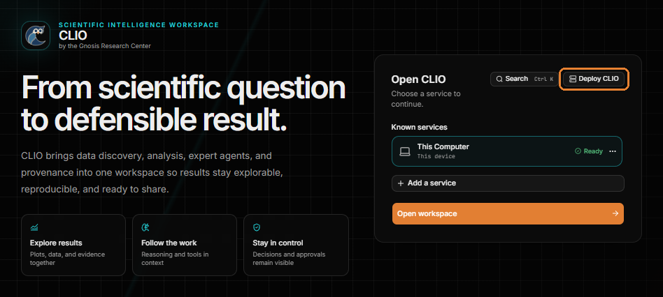

2. Choose a remote host.

   In the **Deploy CLIO** dialog, choose **Remote host**.

   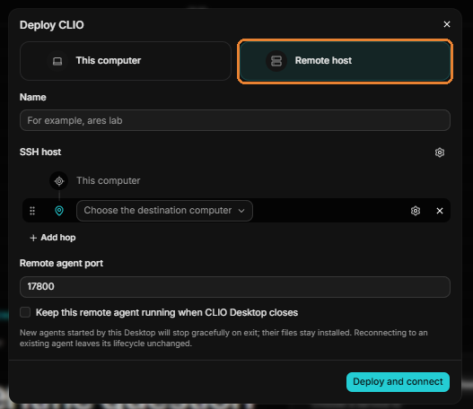

3. Name the deployment.

   In **Name**, enter a name you will recognize, for example `Notchpeak1 Login`.

   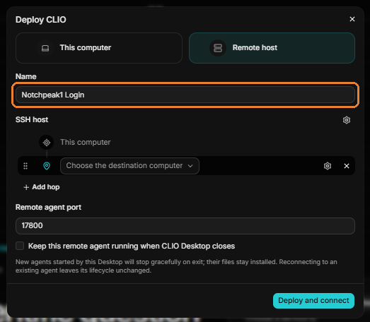

4. Choose how to reach the remote computer.

   Under **SSH host**, open **Choose the destination computer**. It offers two options:

   - **Type an OpenSSH alias or address...** connects with a host alias from your SSH configuration or an address you type.
   - **Add another computer...** saves a new computer to connect to.

   This tutorial uses **Type an OpenSSH alias or address...**.

   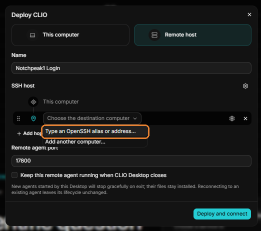

5. Enter the remote address.

   Type your username and the remote computer's address as `username@hostname`, for example `username@notchpeak1.chpc.utah.edu`. Choose the checkmark to confirm it.

   <Aside type="tip">
   Specify the login node explicitly. On many HPC systems, the general cluster hostname is load-balanced across several login nodes, so each connection may be assigned to a different node. For example, at the University of Utah, `notchpeak.chpc.utah.edu` can resolve to either `notchpeak1` or `notchpeak2`. Entering a specific node, such as `notchpeak1.chpc.utah.edu`, ensures that CLIO connects to the same login node each time.
   </Aside>

   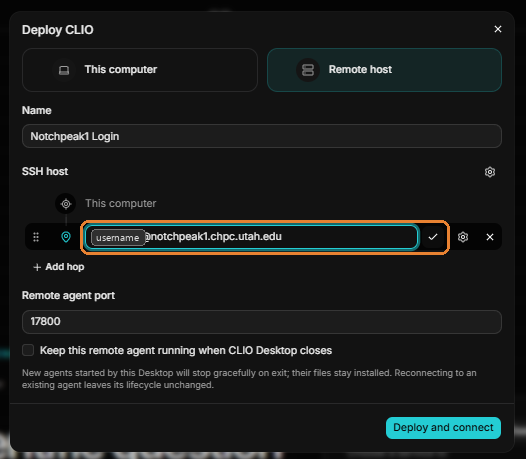

6. Configure the host.

   A **Configure** window opens with the **Address**, **Port**, **Username**, and **Name** filled in from what you typed. Check that the **Address**, **Port**, and **Username** are correct. **Name** is a label for this host, and you can change it to any name you like.

   Under **Authentication**, choose how CLIO signs in to the remote computer. You can paste a private key, choose a key file with **Choose key file**, or leave the key empty to use your SSH agent or OpenSSH configuration. This tutorial leaves the key empty and relies on SSH.

   <Aside type="note">
   Which option is best depends on your HPC center's policies. Check its documentation for how it expects you to sign in over SSH.
   </Aside>

   **Advanced host settings** lets you set the **Remote platform** and the **CLIO install and runtime location**. For a login node, keep the defaults: **Detect automatically** and `$HOME/.local/share/clio`.

   Choose **Test connection** to check that CLIO can reach the remote computer, then choose **Save host**.

   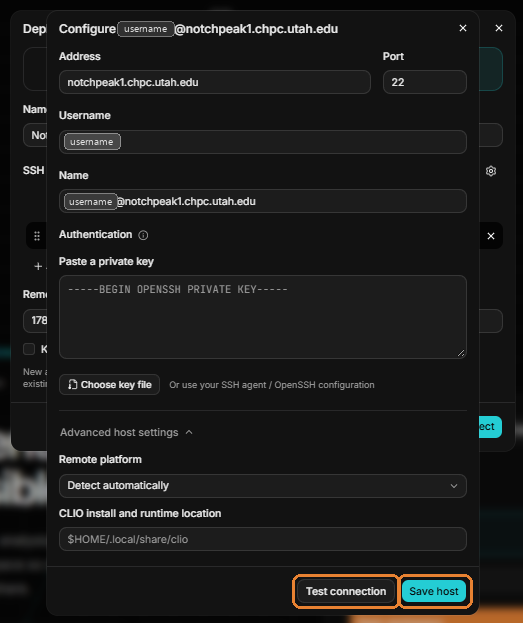

7. Add a hop to the compute node.

   To run CLIO on a compute node, connect through the login node you just saved. Choose **Add hop**. The login node moves up to become the first hop, and a new **Choose the destination computer** row appears below it for the compute node.

   Open **Choose the destination computer** and choose **Type an OpenSSH alias or address...**.

   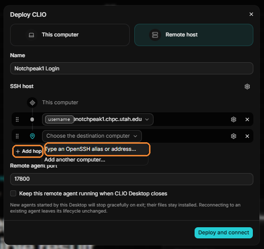

8. Configure the compute node.

   Enter the compute node in the new row, then choose the settings gear on that row to open **Add an SSH host**.

   In **Address**, enter the compute node's hostname, for example `notch351`. The **Reached via** line below **Name** shows that CLIO connects to it through the login node.

   In **Name**, enter any name you like. This tutorial uses `ssh username@notchpeak.chpc.utah.edu "ssh notch351"`, which describes the SSH command the hop effectively runs: connect to the login node, then from there to the compute node. A simpler name, such as `notch351`, works just as well.

   Set **Authentication** the same way you did for the login node.

   Under **Advanced host settings**, you can set a specific directory for the CLIO install in **CLIO install and runtime location**.

   Choose **Test connection** to check that CLIO can reach the compute node, then choose **Save host**.

   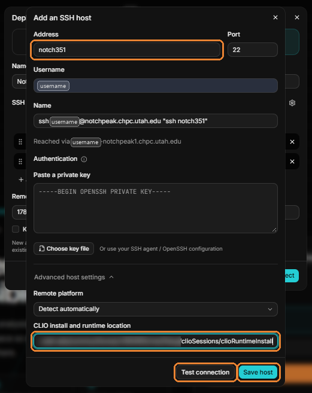

9. Choose a port.

   Back in **Deploy CLIO**, the **SSH host** route now runs from this computer through the login node to the compute node.

   In **Remote agent port**, enter the port the CLIO agent listens on. The default is `17800`, and you can choose any free port. This tutorial uses `17855`.

   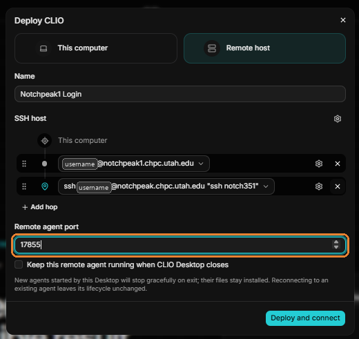

10. Choose whether the agent keeps running, then deploy.

    **Keep this remote agent running when CLIO Desktop closes** controls what happens to the agent when you close the desktop app:

    - Unchecked, an agent started by the desktop app stops when you close the app. Its files stay installed on the remote computer.
    - Checked, the agent keeps running after you close the app.

    Reconnecting to an agent that is already running does not change how it stops.

    Choose **Deploy and connect**.

    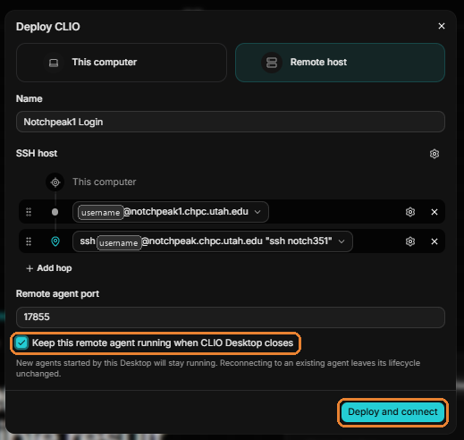

11. Sign in and follow the deployment.

    CLIO shows each stage of the deployment as it runs, with the time each one takes:

    - **Connecting over SSH**
    - **Authenticating**
    - **Detecting platform**
    - **Installing CLIO**
    - **Starting server**
    - **Opening tunnel**
    - **Connecting to CLIO**

    If the remote computer asks for a password, a **Password** box appears. Enter your password and choose **Continue**. What you are asked for depends on your HPC center's policies. Some centers also ask for a second factor, and you may not see a prompt at all if you sign in with SSH keys.

    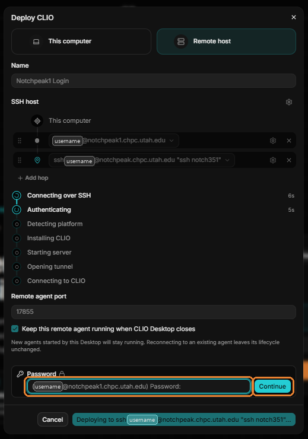

</Steps>

:::note[Captures needed]
- The deployment with every stage complete.
- The new service listed under **Known services** on the start screen.
- A workspace open on the remote service.
:::
